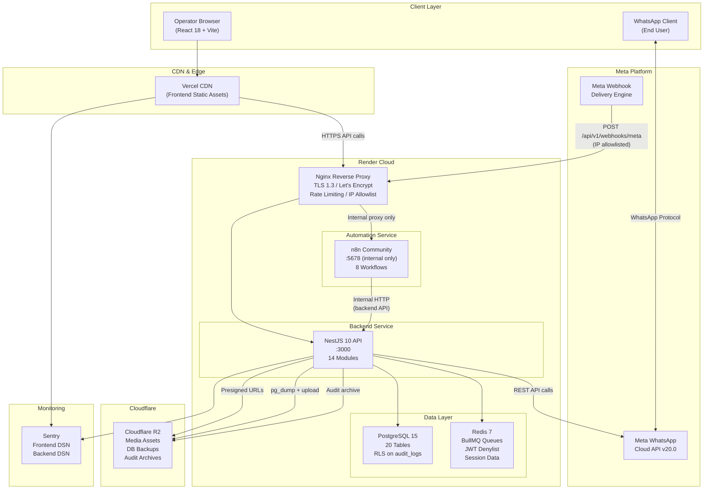
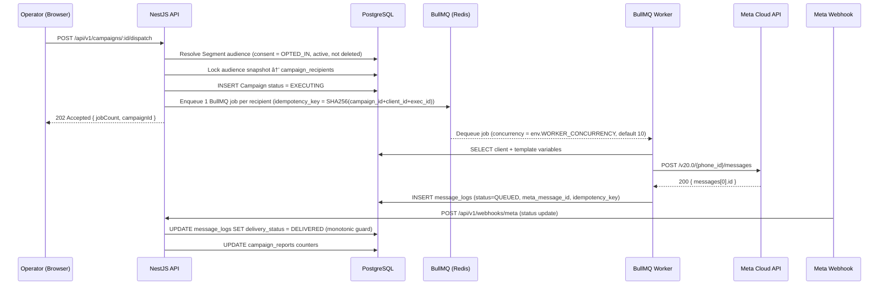
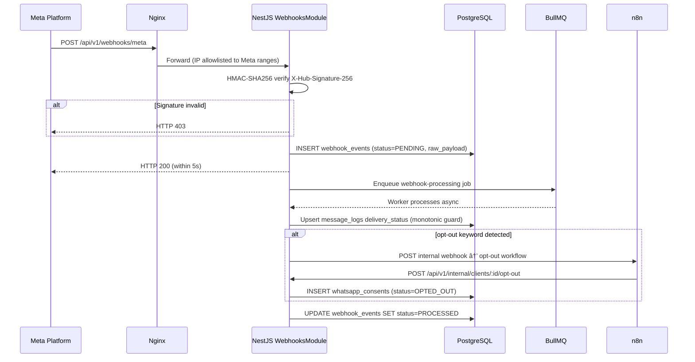
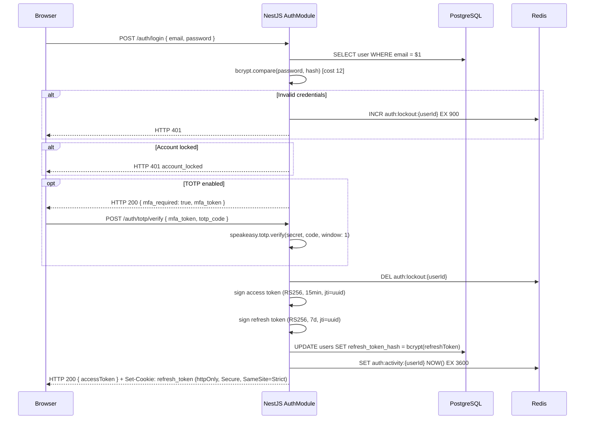

# Design Document

## Overview

The **Wealth Trade Stock Market — WhatsApp Customer Engagement & Automation Platform** is a multi-tenant, production-grade SaaS application that enables authorized employees (Operators) to send personalized, automated, and scheduled WhatsApp messages to registered Clients via the Meta WhatsApp Cloud API v20.0.

### Design Principles

1. **PostgreSQL as the single source of truth** — n8n never owns or mutates business data; it orchestrates jobs by calling the Platform's internal API.
2. **Asynchronous-first messaging** — every outbound WhatsApp message is enqueued in BullMQ; no message is dispatched synchronously from an HTTP request handler.
3. **Idempotency everywhere** — all queue jobs carry a SHA-256 Idempotency_Key; webhook processing uses upsert semantics on Meta message IDs.
4. **Append-only compliance data** — Audit_Log and Consent_Record rows are never mutated; PostgreSQL Row-Level Security (RLS) enforces this at the database layer.
5. **Secrets only in environment variables** — no credentials appear in source code, Dockerfiles, or committed configuration files.
6. **Soft deletes on all sensitive entities** — Clients, MediaAssets, and Templates are never hard-deleted; `deleted_at` timestamps gate all query filters.
7. **DPDP 2023 compliance by design** — consent versioning, right-to-erasure anonymization, and 5-year retention are enforced by the data model and scheduled jobs, not by convention.

### Technology Stack

| Layer | Technology |
|---|---|
| Frontend | React 18 + TypeScript + Vite + Tailwind CSS + shadcn/ui → Vercel |
| Backend | NestJS 10 + TypeScript + Prisma ORM → Render (Docker) |
| Database | PostgreSQL 15 (Render managed) |
| Queue | Redis 7 (Render managed) + BullMQ |
| Automation | n8n Community Edition (Docker on Render, internal network only) |
| Messaging | Meta WhatsApp Cloud API v20.0 |
| Storage | Cloudflare R2 (S3-compatible presigned URLs) |
| Auth | Custom JWT — access 15 min, refresh 7 d, Redis denylist |
| Monitoring | Sentry (separate DSNs for frontend and backend) |
| Reverse Proxy | Nginx + Let's Encrypt SSL (Docker on Render) |
| CI/CD | GitHub → Vercel (frontend), Render Deploy Hooks (backend Docker) |

---

## Architecture

### System Architecture Overview



### Request Flow — Campaign Dispatch



### Webhook Processing Flow



---

## Components and Interfaces

### Backend Module Architecture

#### AuthModule (`src/auth/`)

**Responsibilities:**
- Credential validation against `users` table (bcrypt compare, cost factor 12)
- JWT access token issuance (RS256, 15-minute expiry, payload: `{ sub, role, jti }`)
- JWT refresh token issuance (RS256, 7-day expiry, stored hash in `users.refresh_token_hash`)
- Refresh token rotation with Redis denylist (`auth:denylist:{jti}` key, TTL = remaining validity)
- Account lockout after 5 consecutive failures within 15-minute rolling window (`auth:lockout:{userId}` counter, Redis INCR + EXPIRE)
- TOTP verification via `speakeasy` library (window ±1 step, 30s TOTP period)
- Inactivity session expiry: last-activity timestamp updated on every authenticated request (`auth:activity:{userId}`)
- HTTP 301 redirect enforcement (Nginx handles; API enforces HTTPS-only via `FORCE_HTTPS=true` env flag)

**Key Interfaces:**
```typescript
interface JwtPayload {
  sub: string;        // userId (UUID)
  role: UserRole;     // Super_Admin | Admin | Marketing_Employee | Operator | Viewer
  jti: string;        // JWT ID (UUID v4) — used as denylist key
  iat: number;
  exp: number;
}

interface TokenPair {
  accessToken: string;
  refreshToken: string;
  expiresIn: 900;      // seconds
}
```

**Guards:**
- `JwtAuthGuard` — validates access token, checks Redis denylist, checks inactivity
- `RolesGuard` — checks `@Roles()` decorator against `JwtPayload.role`
- `PermissionsGuard` — checks fine-grained `@RequirePermissions()` against `role_permissions` table

---

#### UsersModule (`src/users/`)

**Responsibilities:**
- Operator CRUD (Super_Admin only for create/delete, Admin for read)
- Password hashing with bcrypt (cost 12) before persist
- Role assignment with atomically committed Audit_Log entry (same Prisma transaction)
- Token invalidation on role change (publish to `auth:invalidate:{userId}` Redis channel; JwtAuthGuard subscribes)
- TOTP setup and verification flow (QR code generation via `qrcode` package, secret stored encrypted in `users.totp_secret`)

---

#### ClientsModule (`src/clients/`)

**Responsibilities:**
- Client CRUD with field-level validation (E.164, RFC 5321, ISO 639-1, ISO 8601)
- E.164 normalization via `libphonenumber-js` before uniqueness check
- CSV/XLSX import pipeline: stream-parse with `papaparse` → validate every row → transactional bulk insert or return structured error report
- Soft delete (`deleted_at` timestamp); `BaseClientQuery` scope always adds `WHERE deleted_at IS NULL`
- Paginated search: full-text GIN index on `full_name` tsvector, B-tree index on `whatsapp_number`
- Export: generate CSV asynchronously via BullMQ job `client-export`; upload to R2; return presigned URL via in-platform notification
- Right-to-erasure: anonymize `full_name`, `whatsapp_number`, `email`, `date_of_birth`, `wedding_anniversary` with deterministic placeholder `ERASED_{uuid}` for audit traceability

---

#### ConsentModule (`src/consent/`)

**Responsibilities:**
- Immutable consent record creation (`whatsapp_consents` — no UPDATE ever)
- Current consent status derived via `MAX(recorded_at)` subquery or materialized view
- Opt-out dead-letter queue: failed opt-out writes → `consent:dlq` BullMQ queue → Super_Admin alert
- Marketing suppression: `consent_status != OPTED_IN` guard applied at both audience resolution and queue-insertion time (double check per Requirement 4.9)
- Consent Register export: async BullMQ job, R2 upload, presigned URL

---

#### TemplatesModule (`src/templates/`)

**Responsibilities:**
- Template creation with `{{N}}` placeholder extraction via regex `/\{\{(\d+)\}\}/g`
- Variable completeness validation before Meta submission
- Meta Template API submission (`POST /v20.0/{waba_id}/message_templates`)
- Approval status polling (every 10 min via BullMQ repeatable job `template-status-poll`)
- Version management: each submission creates a new `template_versions` row; previous versions remain immutable
- Quality rating sync: BullMQ repeatable job `template-quality-sync` (every 24h + webhook-triggered)
- Prevents deletion when referenced by active/scheduled campaigns (FK constraint + application guard)

---

#### CampaignsModule (`src/campaigns/`)

**Responsibilities:**
- Campaign creation with audience pre-resolution (count returned within 3s via indexed query)
- Mandatory confirmation gate: show recipient count, template preview, estimated cost (from `application_settings.meta_pricing`), category
- Audience locking: at dispatch time, INSERT all resolved client IDs into `campaign_recipients` within single transaction
- BullMQ job insertion: one job per recipient, `idempotency_key = SHA256(campaignId + clientId + executionId)` via Node.js `crypto.createHash('sha256')`
- Duplicate prevention: Redis SET NX on idempotency key before queue insertion; 24h TTL
- Pause/Resume: BullMQ queue drain control via `queue.pause()` / `queue.resume()`
- Campaign cancel: `queue.obliterate({ force: false })` on campaign-specific queue; mark CANCELLED in DB
- Rate limiting: BullMQ rate limiter (`{ max: N, duration: 1000 }`) where N = per-second tier from `application_settings`
- 24h deduplication window enforced via `message_logs` unique index on `idempotency_key`

---

#### WebhooksModule (`src/webhooks/`)

**Responsibilities:**
- GET handler for Meta endpoint verification (`hub.mode`, `hub.verify_token`, `hub.challenge`)
- POST handler: HMAC-SHA256 verification using `crypto.timingSafeEqual` within 5s
- Raw payload stored in `webhook_events` before async processing begins
- BullMQ `webhook-processing` queue: status updates + opt-out detection
- Monotonic status guard: `UPDATE message_logs SET delivery_status = $new WHERE delivery_status < $new` (enum-ordered)
- Opt-out keyword matching: case-insensitive exact-word regex per language from `application_settings.opt_out_keywords`

---

#### QueueModule (`src/queue/`)

**Responsibilities:**
- BullMQ `Queue` and `Worker` factory for all queues
- Redis connection config (AUTH password, TLS for Render Redis URL)
- Global retry strategy: `{ attempts: 5, backoff: { type: 'exponential', delay: 30000 } }`
- Dead-letter queue pattern: failed jobs after max attempts → `{queue}:dlq` via `Worker.on('failed')` handler
- Job retention: completed TTL 24h (`removeOnComplete: { age: 86400 }`), failed TTL 7d (`removeOnFail: { age: 604800 }`)
- Concurrency: `WORKER_CONCURRENCY` env var (validated 1–100 range at startup)
- BullMQ Board UI accessible only on internal network (not exposed via Nginx)

**Queue Inventory:**

| Queue Name | Producer | Worker | Description |
|---|---|---|---|
| `campaign-messages` | CampaignsModule | CampaignMessageWorker | One job per recipient per campaign |
| `webhook-processing` | WebhooksModule | WebhookProcessingWorker | Async Meta webhook event processing |
| `consent-dlq` | ConsentModule | ConsentDlqWorker | Failed opt-out events |
| `template-status-poll` | TemplatesModule (repeatable) | TemplateStatusWorker | Meta approval status polling |
| `template-quality-sync` | TemplatesModule (repeatable) | TemplateQualityWorker | Meta quality rating sync |
| `client-export` | ClientsModule | ClientExportWorker | Async CSV export generation |
| `campaign-report-export` | AnalyticsModule | CampaignExportWorker | Async PDF/CSV export generation |
| `audit-archive` | AuditModule (repeatable) | AuditArchiveWorker | Monthly R2 archival of old audit logs |
| `retention-cleanup` | SchedulerModule (repeatable) | RetentionCleanupWorker | Nightly anonymization of expired records |
| `db-backup` | SchedulerModule (repeatable) | DbBackupWorker | Daily pg_dump to R2 |

---

#### MediaModule (`src/media/`)

**Responsibilities:**
- Presigned upload URL generation via `@aws-sdk/client-s3` + `@aws-sdk/s3-request-presigner` (10-min validity)
- Upload confirmation: client POSTs to backend after R2 upload; backend fetches object metadata to verify existence and size
- MIME type validation: magic-byte check via `file-type` package (not just extension/Content-Type header)
- Virus scan integration: ClamAV sidecar container; file streamed from R2, scanned, result checked before `media_assets` record confirmed
- Storage quota enforcement: `SUM(file_size)` query on `media_assets WHERE org_id = $1 AND deleted_at IS NULL`
- Meta media upload: `POST /v20.0/{phone_id}/media` with form-data stream from R2; store `meta_media_id` in `media_assets`
- Soft delete + 30-day R2 cleanup via `retention-cleanup` worker

---

#### AnalyticsModule (`src/analytics/`)

**Responsibilities:**
- Real-time campaign metrics via materialized view `mv_campaign_stats` refreshed on `webhook_events` insert trigger (or BullMQ job for high-volume campaigns)
- Dashboard aggregate query: indexed on `(dispatched_at, delivery_status, template_category)`
- Cost calculation: `pricing_rate(category, dispatched_at)` looks up `application_settings.meta_pricing` JSONB array, selects entry with MAX `effective_date <= dispatched_at`
- Export: async BullMQ job; `jsPDF` for PDF, `csv-stringify` for CSV; upload to R2; presigned URL via notification
- Failure rate alert: `delivery_failed / total_dispatched > 0.10` check on each webhook batch; email via `nodemailer`

---

#### AuditModule (`src/audit/`)

**Responsibilities:**
- `AuditService.log(entry: CreateAuditLogDto)` called transactionally from every write operation
- PostgreSQL RLS policy: `CREATE POLICY audit_no_mutation ON audit_logs FOR ALL TO app_user USING (false) WITH CHECK (true)` — only INSERT allowed
- Monthly archive: SELECT rows WHERE `created_at < NOW() - INTERVAL '1 year'`, serialize to NDJSON, gzip, upload to R2 `audit-archive/{year}/{month}.ndjson.gz`, DELETE original rows
- PII access control: `SELECT` on `before_state`, `after_state` columns gated by `RLS policy` restricting to `Super_Admin` and `Admin` roles

---

#### AutomationModule (`src/automation/`)

**Responsibilities:**
- Automation rule CRUD (stored in `automation_rules` table)
- n8n workflow registration via n8n REST API (internal network: `http://n8n:5678/api/v1/workflows`)
- Execution history sync: poll n8n execution API → persist results to `automation_rules` log
- Missed-execution detection on startup: compare last execution timestamp against expected schedule; log missed executions without retroactive dispatch
- Internal webhook endpoints (`/api/v1/internal/automation/*`) consumed only by n8n (IP-restricted to Docker internal network)

---

#### SettingsModule (`src/settings/`)

**Responsibilities:**
- `application_settings` table: key-value store with JSONB `value` column
- Hot-reload: settings cached in `Map<string, ConfigValue>` in memory; cache invalidated on UPDATE via PostgreSQL `LISTEN/NOTIFY` (`pg_notify('settings_changed', key)`)
- Validation: Zod schemas per setting key (e.g., webhook URL regex, ISO 639-1 enum, positive integer for retention period)
- Pricing rate lookup: `SELECT value FROM application_settings WHERE key = 'meta_pricing'` returns JSONB array `[{ category, rate_inr, effective_date }]`; sorted and binary-searched by `effective_date`

---

#### HealthModule (`src/health/`)

**Responsibilities:**
- `GET /api/v1/health` — no auth required
- Checks: Prisma `SELECT 1` ping, Redis `PING`, n8n internal HTTP ping
- Response: `{ service: 'wt-whatsapp-api', version: pkg.version, status: 'healthy'|'degraded', database: { status, latency_ms }, redis: { status, latency_ms }, timestamp: ISO8601 }`
- Two consecutive DB failures → HTTP 503 on all data endpoints; Super_Admin alert within 2 minutes

---

## Data Models

### Complete Prisma Schema

```prisma
// prisma/schema.prisma
generator client {
  provider        = "prisma-client-js"
  previewFeatures = ["fullTextSearch", "fullTextIndex"]
}

datasource db {
  provider = "postgresql"
  url      = env("DATABASE_URL")
}

// ─────────────────────────────────────────────
// ENUMS
// ─────────────────────────────────────────────

enum UserRole {
  Super_Admin
  Admin
  Marketing_Employee
  Operator
  Viewer
}

enum AccountStatus {
  ACTIVE
  INACTIVE
  LOCKED
}

enum CategoryTier {
  RETAIL
  HNI
  CORPORATE
  PROSPECT
}

enum ConsentStatus {
  OPTED_IN
  OPTED_OUT
  PENDING
}

enum ConsentSource {
  IMPORT
  MANUAL_ENTRY
  WHATSAPP_REPLY
  FORM
  API
}

enum TemplateCategory {
  MARKETING
  UTILITY
  AUTHENTICATION
}

enum TemplateStatus {
  DRAFT
  PENDING_APPROVAL
  APPROVED
  REJECTED
  PAUSED
}

enum TemplateHeaderType {
  TEXT
  IMAGE
  VIDEO
  DOCUMENT
}

enum ButtonType {
  CALL_TO_ACTION
  QUICK_REPLY
}

enum CampaignType {
  BIRTHDAY
  ANNIVERSARY
  FESTIVAL
  ANNOUNCEMENT
  PROMOTIONAL
  SERVICE_NOTIFICATION
}

enum CampaignStatus {
  DRAFT
  PENDING_APPROVAL
  APPROVED
  REJECTED
  SCHEDULED
  EXECUTING
  PAUSED
  COMPLETED
  CANCELLED
}

enum DeliveryStatus {
  QUEUED
  SENT
  DELIVERED
  READ
  FAILED
  UNDELIVERABLE
}

enum WebhookEventStatus {
  PENDING
  PROCESSED
  FAILED
}

enum MediaFileType {
  JPEG
  PNG
  PDF
  MP4
}

enum AuditActionType {
  CREATE
  UPDATE
  DELETE
  RESTORE
  LOGIN
  LOGOUT
  EXPORT
  CAMPAIGN_EXECUTE
  CONSENT_CHANGE
  ROLE_CHANGE
  SETTINGS_CHANGE
  TEMPLATE_SUBMIT
  CAMPAIGN_APPROVE
  CAMPAIGN_REJECT
}

enum AutomationRuleType {
  BIRTHDAY
  ANNIVERSARY
  FESTIVAL
  CAMPAIGN_EXECUTION
  DELIVERY_STATUS
  OPT_OUT
}

enum AutomationStatus {
  ACTIVE
  INACTIVE
  ERROR
}

enum NotificationChannelType {
  EMAIL
  WEBHOOK
}

enum QualityRating {
  GREEN
  YELLOW
  RED
  UNKNOWN
}

// ─────────────────────────────────────────────
// USERS & ROLES
// ─────────────────────────────────────────────

model User {
  id                    String        @id @default(uuid()) @db.Uuid
  email                 String        @unique @db.VarChar(320)
  passwordHash          String        @map("password_hash") @db.VarChar(72)
  fullName              String        @map("full_name") @db.VarChar(150)
  role                  UserRole
  accountStatus         AccountStatus @default(ACTIVE) @map("account_status")
  failedLoginCount      Int           @default(0) @map("failed_login_count")
  lockedAt              DateTime?     @map("locked_at") @db.Timestamptz
  lastActivityAt        DateTime?     @map("last_activity_at") @db.Timestamptz
  totpSecret            String?       @map("totp_secret") @db.VarChar(256)  // encrypted at rest
  totpEnabled           Boolean       @default(false) @map("totp_enabled")
  refreshTokenHash      String?       @map("refresh_token_hash") @db.VarChar(255)
  createdAt             DateTime      @default(now()) @map("created_at") @db.Timestamptz
  updatedAt             DateTime      @updatedAt @map("updated_at") @db.Timestamptz
  deletedAt             DateTime?     @map("deleted_at") @db.Timestamptz

  auditLogsAsActor      AuditLog[]    @relation("AuditActor")
  consentRecords        WhatsappConsent[] @relation("ConsentOperator")
  campaigns             Campaign[]    @relation("CampaignCreator")
  campaignApprovals     Campaign[]    @relation("CampaignApprover")

  @@index([email])
  @@index([role])
  @@map("users")
}

// ─────────────────────────────────────────────
// CLIENTS
// ─────────────────────────────────────────────

model Client {
  id                    String        @id @default(uuid()) @db.Uuid
  fullName              String        @map("full_name") @db.VarChar(150)
  whatsappNumber        String        @unique @map("whatsapp_number") @db.VarChar(20)  // E.164
  email                 String?       @unique @db.VarChar(320)
  dateOfBirth           DateTime?     @map("date_of_birth") @db.Date
  weddingAnniversary    DateTime?     @map("wedding_anniversary") @db.Date
  categoryTier          CategoryTier  @map("category_tier")
  communicationConsent  ConsentStatus @default(PENDING) @map("communication_consent")
  preferredLanguage     String        @map("preferred_language") @db.VarChar(5)  // ISO 639-1
  accountStatus         AccountStatus @default(ACTIVE) @map("account_status")
  createdAt             DateTime      @default(now()) @map("created_at") @db.Timestamptz
  updatedAt             DateTime      @updatedAt @map("updated_at") @db.Timestamptz
  deletedAt             DateTime?     @map("deleted_at") @db.Timestamptz

  consentRecords        WhatsappConsent[]
  messageLogs           MessageLog[]
  campaignRecipients    CampaignRecipient[]
  tags                  ClientTag[]

  // Full-text search vector (maintained by DB trigger)
  searchVector          Unsupported("tsvector")?  @map("search_vector")

  @@index([whatsappNumber])
  @@index([email])
  @@index([categoryTier])
  @@index([communicationConsent])
  @@index([accountStatus])
  @@index([preferredLanguage])
  @@index([dateOfBirth])
  @@index([createdAt])
  @@index([deletedAt])
  // GIN index on search_vector created via migration SQL:
  // CREATE INDEX clients_search_vector_idx ON clients USING GIN (search_vector);
  @@map("clients")
}

model ClientTag {
  id        String   @id @default(uuid()) @db.Uuid
  clientId  String   @map("client_id") @db.Uuid
  tag       String   @db.VarChar(100)
  createdAt DateTime @default(now()) @map("created_at") @db.Timestamptz

  client    Client   @relation(fields: [clientId], references: [id])

  @@unique([clientId, tag])
  @@index([tag])
  @@map("client_tags")
}

// ─────────────────────────────────────────────
// CONSENT
// ─────────────────────────────────────────────

model WhatsappConsent {
  id                String        @id @default(uuid()) @db.Uuid
  clientId          String        @map("client_id") @db.Uuid
  consentStatus     ConsentStatus @map("consent_status")
  consentSource     ConsentSource @map("consent_source")
  evidenceReference String?       @map("evidence_reference") @db.VarChar(2048)
  reason            String?       @db.VarChar(500)   // required for MANUAL_ENTRY opt-out
  recordedByUserId  String?       @map("recorded_by_user_id") @db.Uuid  // NULL = SYSTEM
  recordedAt        DateTime      @default(now()) @map("recorded_at") @db.Timestamptz

  client            Client        @relation(fields: [clientId], references: [id])
  recordedBy        User?         @relation("ConsentOperator", fields: [recordedByUserId], references: [id])

  @@index([clientId, recordedAt(sort: Desc)])
  @@index([consentStatus])
  @@index([recordedAt])
  @@map("whatsapp_consents")
}

// ─────────────────────────────────────────────
// TEMPLATES
// ─────────────────────────────────────────────

model MessageTemplate {
  id                String              @id @default(uuid()) @db.Uuid
  name              String              @unique @db.VarChar(512)
  category          TemplateCategory
  language          String              @db.VarChar(5)
  status            TemplateStatus      @default(DRAFT)
  metaTemplateId    String?             @map("meta_template_id") @db.VarChar(255)
  qualityRating     QualityRating       @default(UNKNOWN) @map("quality_rating")
  qualityCheckedAt  DateTime?           @map("quality_checked_at") @db.Timestamptz
  createdByUserId   String              @map("created_by_user_id") @db.Uuid
  deletedAt         DateTime?           @map("deleted_at") @db.Timestamptz
  createdAt         DateTime            @default(now()) @map("created_at") @db.Timestamptz
  updatedAt         DateTime            @updatedAt @map("updated_at") @db.Timestamptz

  versions          TemplateVersion[]
  campaigns         Campaign[]
  mediaAssets       MediaAsset[]

  @@index([status])
  @@index([category])
  @@index([qualityRating])
  @@map("message_templates")
}

model TemplateVersion {
  id                String              @id @default(uuid()) @db.Uuid
  templateId        String              @map("template_id") @db.Uuid
  versionNumber     Int                 @map("version_number")
  status            TemplateStatus      @default(DRAFT)
  bodyText          String              @map("body_text") @db.VarChar(1024)
  headerType        TemplateHeaderType? @map("header_type")
  headerText        String?             @map("header_text") @db.VarChar(60)
  headerMediaId     String?             @map("header_media_id") @db.Uuid  // FK to media_assets
  footerText        String?             @map("footer_text") @db.VarChar(60)
  variableSchema    Json                @map("variable_schema")  // Array<{ name, dataType, source }>
  buttons           Json?               // Array<{ type: ButtonType, text, url?, phone_number? }>
  submittedAt       DateTime?           @map("submitted_at") @db.Timestamptz
  approvedAt        DateTime?           @map("approved_at") @db.Timestamptz
  rejectedAt        DateTime?           @map("rejected_at") @db.Timestamptz
  rejectionReason   String?             @map("rejection_reason") @db.Text
  metaVersionId     String?             @map("meta_version_id") @db.VarChar(255)
  createdAt         DateTime            @default(now()) @map("created_at") @db.Timestamptz

  template          MessageTemplate     @relation(fields: [templateId], references: [id])
  headerMedia       MediaAsset?         @relation(fields: [headerMediaId], references: [id])

  @@unique([templateId, versionNumber])
  @@index([templateId, status])
  @@map("template_versions")
}

// ─────────────────────────────────────────────
// CAMPAIGNS
// ─────────────────────────────────────────────

model Campaign {
  id                  String          @id @default(uuid()) @db.Uuid
  name                String          @unique @db.VarChar(200)
  campaignType        CampaignType    @map("campaign_type")
  status              CampaignStatus  @default(DRAFT)
  templateId          String          @map("template_id") @db.Uuid
  templateVersionId   String?         @map("template_version_id") @db.Uuid
  segmentFilter       Json?           @map("segment_filter")   // Segment criteria JSONB
  resolvedRecipientCount Int          @default(0) @map("resolved_recipient_count")
  scheduledAt         DateTime?       @map("scheduled_at") @db.Timestamptz  // stored UTC
  dispatchedAt        DateTime?       @map("dispatched_at") @db.Timestamptz
  completedAt         DateTime?       @map("completed_at") @db.Timestamptz
  cancelledAt         DateTime?       @map("cancelled_at") @db.Timestamptz
  description         String?         @db.Text
  estimatedCostInr    Decimal?        @map("estimated_cost_inr") @db.Decimal(12, 4)
  actualCostInr       Decimal?        @map("actual_cost_inr") @db.Decimal(12, 4)
  approvedByUserId    String?         @map("approved_by_user_id") @db.Uuid
  approvedAt          DateTime?       @map("approved_at") @db.Timestamptz
  rejectedByUserId    String?         @map("rejected_by_user_id") @db.Uuid
  rejectionReason     String?         @map("rejection_reason") @db.Text
  createdByUserId     String          @map("created_by_user_id") @db.Uuid
  cancelledByUserId   String?         @map("cancelled_by_user_id") @db.Uuid
  createdAt           DateTime        @default(now()) @map("created_at") @db.Timestamptz
  updatedAt           DateTime        @updatedAt @map("updated_at") @db.Timestamptz

  template            MessageTemplate @relation(fields: [templateId], references: [id])
  createdBy           User            @relation("CampaignCreator", fields: [createdByUserId], references: [id])
  approvedBy          User?           @relation("CampaignApprover", fields: [approvedByUserId], references: [id])
  recipients          CampaignRecipient[]
  messageLogs         MessageLog[]
  stateTransitions    CampaignStateTransition[]

  @@index([status])
  @@index([campaignType])
  @@index([scheduledAt])
  @@index([createdByUserId])
  @@map("campaigns")
}

model CampaignRecipient {
  id              String    @id @default(uuid()) @db.Uuid
  campaignId      String    @map("campaign_id") @db.Uuid
  clientId        String    @map("client_id") @db.Uuid
  consentVerified Boolean   @default(false) @map("consent_verified")
  suppressed      Boolean   @default(false)  // opted out between schedule and dispatch
  addedAt         DateTime  @default(now()) @map("added_at") @db.Timestamptz

  campaign        Campaign  @relation(fields: [campaignId], references: [id])
  client          Client    @relation(fields: [clientId], references: [id])

  @@unique([campaignId, clientId])
  @@index([campaignId])
  @@index([clientId])
  @@map("campaign_recipients")
}

model CampaignStateTransition {
  id          String         @id @default(uuid()) @db.Uuid
  campaignId  String         @map("campaign_id") @db.Uuid
  fromStatus  CampaignStatus @map("from_status")
  toStatus    CampaignStatus @map("to_status")
  actorId     String?        @map("actor_id") @db.Uuid   // NULL = SYSTEM
  note        String?        @db.Text
  transitionedAt DateTime    @default(now()) @map("transitioned_at") @db.Timestamptz

  campaign    Campaign       @relation(fields: [campaignId], references: [id])

  @@index([campaignId])
  @@map("campaign_state_transitions")
}

// ─────────────────────────────────────────────
// MESSAGE LOGS
// ─────────────────────────────────────────────

model MessageLog {
  id              String         @id @default(uuid()) @db.Uuid
  campaignId      String?        @map("campaign_id") @db.Uuid
  clientId        String         @map("client_id") @db.Uuid
  templateId      String         @map("template_id") @db.Uuid
  templateCategory TemplateCategory @map("template_category")
  metaMessageId   String?        @unique @map("meta_message_id") @db.VarChar(255)
  bullmqJobId     String?        @map("bullmq_job_id") @db.VarChar(255)
  idempotencyKey  String         @unique @map("idempotency_key") @db.VarChar(255)
  deliveryStatus  DeliveryStatus @default(QUEUED) @map("delivery_status")
  variableValues  Json           @map("variable_values")  // { placeholder_name: resolved_value }
  pricingRateInr  Decimal?       @map("pricing_rate_inr") @db.Decimal(10, 6)
  costInr         Decimal?       @map("cost_inr") @db.Decimal(10, 6)
  errorCode       String?        @map("error_code") @db.VarChar(50)
  errorMessage    String?        @map("error_message") @db.Text
  retryCount      Int            @default(0) @map("retry_count")
  dispatchedAt    DateTime       @default(now()) @map("dispatched_at") @db.Timestamptz
  sentAt          DateTime?      @map("sent_at") @db.Timestamptz
  deliveredAt     DateTime?      @map("delivered_at") @db.Timestamptz
  readAt          DateTime?      @map("read_at") @db.Timestamptz
  failedAt        DateTime?      @map("failed_at") @db.Timestamptz
  createdAt       DateTime       @default(now()) @map("created_at") @db.Timestamptz
  updatedAt       DateTime       @updatedAt @map("updated_at") @db.Timestamptz

  campaign        Campaign?      @relation(fields: [campaignId], references: [id])
  client          Client         @relation(fields: [clientId], references: [id])

  @@index([campaignId, deliveryStatus, dispatchedAt])
  @@index([clientId, dispatchedAt])
  @@index([metaMessageId])
  @@index([idempotencyKey])
  @@index([deliveryStatus])
  @@map("message_logs")
}

// ─────────────────────────────────────────────
// WEBHOOKS
// ─────────────────────────────────────────────

model WebhookEvent {
  id               String             @id @default(uuid()) @db.Uuid
  metaMessageId    String?            @map("meta_message_id") @db.VarChar(255)
  eventType        String             @map("event_type") @db.VarChar(50)  // message_status | message_received
  rawPayload       Json               @map("raw_payload")
  processingStatus WebhookEventStatus @default(PENDING) @map("processing_status")
  processingError  String?            @map("processing_error") @db.Text
  retryCount       Int                @default(0) @map("retry_count")
  receivedAt       DateTime           @default(now()) @map("received_at") @db.Timestamptz
  processedAt      DateTime?          @map("processed_at") @db.Timestamptz
  expiresAt        DateTime           @map("expires_at") @db.Timestamptz  // receivedAt + 90 days

  @@index([metaMessageId])
  @@index([processingStatus])
  @@index([receivedAt])
  @@index([expiresAt])
  @@map("webhook_events")
}

// ─────────────────────────────────────────────
// MEDIA ASSETS
// ─────────────────────────────────────────────

model MediaAsset {
  id              String        @id @default(uuid()) @db.Uuid
  r2ObjectKey     String        @unique @map("r2_object_key") @db.VarChar(1024)
  fileName        String        @map("file_name") @db.VarChar(255)
  mimeType        String        @map("mime_type") @db.VarChar(127)
  fileType        MediaFileType @map("file_type")
  fileSizeBytes   BigInt        @map("file_size_bytes")
  metaMediaId     String?       @map("meta_media_id") @db.VarChar(255)
  uploadedByUserId String       @map("uploaded_by_user_id") @db.Uuid
  virusScanStatus String        @default("PENDING") @map("virus_scan_status") @db.VarChar(20)
  uploadConfirmedAt DateTime?   @map("upload_confirmed_at") @db.Timestamptz
  deletedAt       DateTime?     @map("deleted_at") @db.Timestamptz
  r2PurgeAt       DateTime?     @map("r2_purge_at") @db.Timestamptz  // deletedAt + 30 days
  createdAt       DateTime      @default(now()) @map("created_at") @db.Timestamptz

  templateVersions TemplateVersion[]

  @@index([deletedAt])
  @@index([r2PurgeAt])
  @@map("media_assets")
}

// ─────────────────────────────────────────────
// AUTOMATION
// ─────────────────────────────────────────────

model AutomationRule {
  id              String             @id @default(uuid()) @db.Uuid
  name            String             @db.VarChar(200)
  ruleType        AutomationRuleType @map("rule_type")
  status          AutomationStatus   @default(ACTIVE)
  n8nWorkflowId   String?            @map("n8n_workflow_id") @db.VarChar(255)
  config          Json               // { festivalName, dispatchDate, reminderDate, segmentFilter, templateId, ... }
  lastExecutedAt  DateTime?          @map("last_executed_at") @db.Timestamptz
  nextExecuteAt   DateTime?          @map("next_execute_at") @db.Timestamptz
  createdByUserId String             @map("created_by_user_id") @db.Uuid
  createdAt       DateTime           @default(now()) @map("created_at") @db.Timestamptz
  updatedAt       DateTime           @updatedAt @map("updated_at") @db.Timestamptz

  executions      AutomationExecution[]

  @@index([ruleType, status])
  @@map("automation_rules")
}

model AutomationExecution {
  id              String    @id @default(uuid()) @db.Uuid
  ruleId          String    @map("rule_id") @db.Uuid
  n8nExecutionId  String?   @map("n8n_execution_id") @db.VarChar(255)
  status          String    @db.VarChar(20)  // SUCCESS | FAILED | PARTIAL
  clientsProcessed Int      @default(0) @map("clients_processed")
  messagesQueued  Int       @default(0) @map("messages_queued")
  errorDetails    String?   @map("error_details") @db.Text
  startedAt       DateTime  @map("started_at") @db.Timestamptz
  completedAt     DateTime? @map("completed_at") @db.Timestamptz

  rule            AutomationRule @relation(fields: [ruleId], references: [id])

  @@index([ruleId, startedAt])
  @@map("automation_executions")
}

// ─────────────────────────────────────────────
// AUDIT LOG
// ─────────────────────────────────────────────

model AuditLog {
  id              String          @id @default(uuid()) @db.Uuid
  actorId         String?         @map("actor_id") @db.Uuid   // NULL = SYSTEM
  actorRole       UserRole?       @map("actor_role")
  actionType      AuditActionType @map("action_type")
  resourceType    String          @map("resource_type") @db.VarChar(100)
  resourceId      String?         @map("resource_id") @db.Uuid
  ipAddress       String?         @map("ip_address") @db.VarChar(45)  // IPv6 max length
  beforeState     Json?           @map("before_state")  // PII fields included; RLS restricts read to Admin+
  afterState      Json?           @map("after_state")
  metadata        Json?           // non-PII supplementary data
  createdAt       DateTime        @default(now()) @map("created_at") @db.Timestamptz

  actor           User?           @relation("AuditActor", fields: [actorId], references: [id])

  @@index([actorId])
  @@index([actionType])
  @@index([resourceType, resourceId])
  @@index([createdAt])
  @@index([ipAddress])
  @@map("audit_logs")
}

// ─────────────────────────────────────────────
// SETTINGS & NOTIFICATIONS
// ─────────────────────────────────────────────

model ApplicationSetting {
  key         String   @id @db.VarChar(100)
  value       Json
  updatedByUserId String? @map("updated_by_user_id") @db.Uuid
  updatedAt   DateTime @default(now()) @map("updated_at") @db.Timestamptz

  @@map("application_settings")
}

model NotificationChannel {
  id            String                  @id @default(uuid()) @db.Uuid
  channelType   NotificationChannelType @map("channel_type")
  config        Json                    // { email } or { webhookUrl, secret }
  isActive      Boolean                 @default(true) @map("is_active")
  createdAt     DateTime                @default(now()) @map("created_at") @db.Timestamptz

  @@map("notification_channels")
}
```

### Key Database Migrations (SQL — supplemental to Prisma)

```sql
-- Full-text search trigger on clients
CREATE OR REPLACE FUNCTION clients_search_vector_update() RETURNS trigger AS $$
BEGIN
  NEW.search_vector := to_tsvector('english', 
    COALESCE(NEW.full_name, '') || ' ' || 
    COALESCE(NEW.whatsapp_number, '')
  );
  RETURN NEW;
END;
$$ LANGUAGE plpgsql;

CREATE TRIGGER clients_search_vector_trigger
  BEFORE INSERT OR UPDATE ON clients
  FOR EACH ROW EXECUTE FUNCTION clients_search_vector_update();

CREATE INDEX clients_search_vector_idx ON clients USING GIN (search_vector);

-- Row-Level Security on audit_logs (append-only)
ALTER TABLE audit_logs ENABLE ROW LEVEL SECURITY;
CREATE POLICY audit_insert_only ON audit_logs
  FOR INSERT TO app_role WITH CHECK (true);
-- No UPDATE or DELETE policy = denied by default

-- Delivery status ordering function
CREATE TYPE delivery_status_order AS (ord INT);
CREATE OR REPLACE FUNCTION delivery_status_ordinal(s delivery_status) RETURNS INT AS $$
BEGIN
  RETURN CASE s
    WHEN 'QUEUED' THEN 0
    WHEN 'SENT' THEN 1
    WHEN 'DELIVERED' THEN 2
    WHEN 'READ' THEN 3
    WHEN 'FAILED' THEN 4
    WHEN 'UNDELIVERABLE' THEN 5
    ELSE -1
  END;
END;
$$ LANGUAGE plpgsql IMMUTABLE;

-- Monotonic delivery status update (only advances, never regresses)
CREATE OR REPLACE FUNCTION update_delivery_status_monotonic(
  p_meta_message_id VARCHAR,
  p_new_status delivery_status,
  p_timestamp TIMESTAMPTZ
) RETURNS VOID AS $$
BEGIN
  UPDATE message_logs
  SET 
    delivery_status = p_new_status,
    sent_at = CASE WHEN p_new_status = 'SENT' THEN p_timestamp ELSE sent_at END,
    delivered_at = CASE WHEN p_new_status = 'DELIVERED' THEN p_timestamp ELSE delivered_at END,
    read_at = CASE WHEN p_new_status = 'READ' THEN p_timestamp ELSE read_at END,
    failed_at = CASE WHEN p_new_status = 'FAILED' THEN p_timestamp ELSE failed_at END,
    updated_at = NOW()
  WHERE 
    meta_message_id = p_meta_message_id
    AND delivery_status_ordinal(delivery_status) < delivery_status_ordinal(p_new_status);
END;
$$ LANGUAGE plpgsql;

-- PostgreSQL LISTEN/NOTIFY for settings hot-reload
CREATE OR REPLACE FUNCTION notify_settings_changed() RETURNS trigger AS $$
BEGIN
  PERFORM pg_notify('settings_changed', NEW.key);
  RETURN NEW;
END;
$$ LANGUAGE plpgsql;

CREATE TRIGGER settings_notify_trigger
  AFTER INSERT OR UPDATE ON application_settings
  FOR EACH ROW EXECUTE FUNCTION notify_settings_changed();

-- Composite index for Analytics queries
CREATE INDEX message_logs_analytics_idx ON message_logs (campaign_id, delivery_status, dispatched_at);

-- NOTE: Client.communicationConsent is a denormalized cache of the current consent status.
-- It MUST be updated atomically whenever a WhatsappConsent row is inserted:
--   UPDATE clients SET communication_consent = $new_status WHERE id = $client_id
-- This ensures O(1) consent lookups during audience resolution without a subquery.

-- Webhook event 90-day TTL cleanup (via retention-cleanup worker)
CREATE INDEX webhook_events_expires_at_idx ON webhook_events (expires_at) WHERE processing_status = 'PROCESSED';
```

### Materialized View for Campaign Analytics

```sql
CREATE MATERIALIZED VIEW mv_campaign_stats AS
SELECT
  c.id AS campaign_id,
  c.name AS campaign_name,
  COUNT(ml.id) AS total_recipients,
  COUNT(ml.id) FILTER (WHERE ml.delivery_status = 'SENT') AS sent_count,
  COUNT(ml.id) FILTER (WHERE ml.delivery_status = 'DELIVERED') AS delivered_count,
  COUNT(ml.id) FILTER (WHERE ml.delivery_status = 'READ') AS read_count,
  COUNT(ml.id) FILTER (WHERE ml.delivery_status IN ('FAILED', 'UNDELIVERABLE')) AS failed_count,
  COUNT(cr.id) FILTER (WHERE cr.suppressed = TRUE) AS suppressed_count,
  COUNT(ml.id) FILTER (WHERE ml.retry_count > 0) AS retry_count,
  ROUND(COUNT(ml.id) FILTER (WHERE ml.delivery_status = 'DELIVERED')::NUMERIC / NULLIF(COUNT(ml.id), 0) * 100, 2) AS delivery_rate,
  ROUND(COUNT(ml.id) FILTER (WHERE ml.delivery_status = 'READ')::NUMERIC / NULLIF(COUNT(ml.id), 0) * 100, 2) AS read_rate,
  SUM(ml.cost_inr) AS total_cost_inr
FROM campaigns c
LEFT JOIN message_logs ml ON ml.campaign_id = c.id
LEFT JOIN campaign_recipients cr ON cr.campaign_id = c.id AND cr.client_id = ml.client_id
GROUP BY c.id, c.name
WITH NO DATA;

CREATE UNIQUE INDEX mv_campaign_stats_pk ON mv_campaign_stats (campaign_id);
-- Refreshed by BullMQ webhook-processing worker after each batch
```

---

## API Design

### Authentication Endpoints

| Method | Path | Auth | Description |
|---|---|---|---|
| `POST` | `/api/v1/auth/login` | None | Submit credentials; returns `TokenPair` |
| `POST` | `/api/v1/auth/refresh` | Refresh JWT | Rotate refresh token; returns new `TokenPair` |
| `POST` | `/api/v1/auth/logout` | Access JWT | Revoke refresh token; add JTI to Redis denylist |
| `POST` | `/api/v1/auth/totp/setup` | Access JWT | Generate TOTP secret + QR code for Operator |
| `POST` | `/api/v1/auth/totp/verify` | Access JWT | Verify TOTP code during login flow |

### Users Endpoints

| Method | Path | Auth | Min Role | Description |
|---|---|---|---|---|
| `GET` | `/api/v1/users` | Access JWT | Admin | List Operators (paginated) |
| `POST` | `/api/v1/users` | Access JWT | Super_Admin | Create Operator account |
| `GET` | `/api/v1/users/:id` | Access JWT | Admin | Get Operator detail |
| `PATCH` | `/api/v1/users/:id` | Access JWT | Super_Admin | Update Operator profile |
| `DELETE` | `/api/v1/users/:id` | Access JWT | Super_Admin | Soft-delete Operator |
| `PATCH` | `/api/v1/users/:id/role` | Access JWT | Super_Admin | Change role (invalidates tokens) |
| `POST` | `/api/v1/users/:id/unlock` | Access JWT | Admin | Unlock locked account |

### Clients Endpoints

| Method | Path | Auth | Min Role | Description |
|---|---|---|---|---|
| `GET` | `/api/v1/clients` | Access JWT | Operator | List clients with filter/pagination |
| `POST` | `/api/v1/clients` | Access JWT | Admin | Create single client |
| `GET` | `/api/v1/clients/:id` | Access JWT | Operator | Get client detail + consent history |
| `PATCH` | `/api/v1/clients/:id` | Access JWT | Admin | Update client fields |
| `DELETE` | `/api/v1/clients/:id` | Access JWT | Admin | Soft-delete client |
| `POST` | `/api/v1/clients/:id/restore` | Access JWT | Super_Admin | Restore soft-deleted client |
| `GET` | `/api/v1/clients/:id/messages` | Access JWT | Operator | Paginated message history (page_size=25) |
| `POST` | `/api/v1/clients/import` | Access JWT | Admin | Upload CSV/XLSX; returns job ID |
| `GET` | `/api/v1/clients/import/:jobId` | Access JWT | Admin | Poll import job status + error report |
| `POST` | `/api/v1/clients/export` | Access JWT | Admin | Trigger async export; returns job ID |
| `GET` | `/api/v1/clients/export/:jobId` | Access JWT | Admin | Poll export status; returns presigned URL |
| `POST` | `/api/v1/clients/:id/erase` | Access JWT | Admin | DPDP right-to-erasure anonymization |

### Consent Endpoints

| Method | Path | Auth | Min Role | Description |
|---|---|---|---|---|
| `GET` | `/api/v1/consent/:clientId` | Access JWT | Operator | Full consent history for client |
| `POST` | `/api/v1/consent/:clientId/opt-in` | Access JWT | Admin | Manual opt-in with evidence |
| `POST` | `/api/v1/consent/:clientId/opt-out` | Access JWT | Admin | Manual opt-out with reason |
| `POST` | `/api/v1/consent/export` | Access JWT | Admin | Async Consent Register CSV export |
| `GET` | `/api/v1/consent/export/:jobId` | Access JWT | Admin | Poll export status; presigned URL |

### Templates Endpoints

| Method | Path | Auth | Min Role | Description |
|---|---|---|---|---|
| `GET` | `/api/v1/templates` | Access JWT | Marketing_Employee | List templates with status filter |
| `POST` | `/api/v1/templates` | Access JWT | Marketing_Employee | Create template draft |
| `GET` | `/api/v1/templates/:id` | Access JWT | Marketing_Employee | Get template + all versions |
| `PATCH` | `/api/v1/templates/:id` | Access JWT | Marketing_Employee | Update draft template |
| `DELETE` | `/api/v1/templates/:id` | Access JWT | Admin | Soft-delete (blocked if active campaigns) |
| `POST` | `/api/v1/templates/:id/submit` | Access JWT | Marketing_Employee | Submit to Meta for approval |
| `GET` | `/api/v1/templates/:id/preview` | Access JWT | Marketing_Employee | Render preview with sample client data |
| `POST` | `/api/v1/templates/:id/versions` | Access JWT | Marketing_Employee | Create new version from approved template |

### Campaigns Endpoints

| Method | Path | Auth | Min Role | Description |
|---|---|---|---|---|
| `GET` | `/api/v1/campaigns` | Access JWT | Viewer | List campaigns with status filter |
| `POST` | `/api/v1/campaigns` | Access JWT | Marketing_Employee | Create campaign draft |
| `GET` | `/api/v1/campaigns/:id` | Access JWT | Viewer | Get campaign detail + stats |
| `PATCH` | `/api/v1/campaigns/:id` | Access JWT | Marketing_Employee | Update draft campaign |
| `DELETE` | `/api/v1/campaigns/:id` | Access JWT | Admin | Cancel campaign |
| `POST` | `/api/v1/campaigns/:id/resolve-audience` | Access JWT | Marketing_Employee | Re-evaluate segment; return count |
| `POST` | `/api/v1/campaigns/:id/submit-approval` | Access JWT | Marketing_Employee | Submit for Admin approval |
| `POST` | `/api/v1/campaigns/:id/approve` | Access JWT | Admin | Approve campaign |
| `POST` | `/api/v1/campaigns/:id/reject` | Access JWT | Admin | Reject with reason |
| `POST` | `/api/v1/campaigns/:id/schedule` | Access JWT | Admin | Schedule dispatch at IST datetime |
| `POST` | `/api/v1/campaigns/:id/dispatch` | Access JWT | Admin | Immediate dispatch |
| `POST` | `/api/v1/campaigns/:id/pause` | Access JWT | Admin | Pause queue drain |
| `POST` | `/api/v1/campaigns/:id/resume` | Access JWT | Admin | Resume queue drain |
| `GET` | `/api/v1/campaigns/:id/report` | Access JWT | Viewer | Campaign analytics report |
| `POST` | `/api/v1/campaigns/:id/export` | Access JWT | Admin | Async CSV/PDF export |

### Webhooks Endpoints

| Method | Path | Auth | Description |
|---|---|---|---|
| `GET` | `/api/v1/webhooks/meta` | None (verify token) | Meta endpoint verification handshake |
| `POST` | `/api/v1/webhooks/meta` | HMAC-SHA256 | Receive Meta delivery status + incoming messages |

### Media Endpoints

| Method | Path | Auth | Min Role | Description |
|---|---|---|---|---|
| `POST` | `/api/v1/media/upload-url` | Access JWT | Marketing_Employee | Generate R2 presigned upload URL (10 min) |
| `POST` | `/api/v1/media/confirm-upload` | Access JWT | Marketing_Employee | Confirm R2 upload; trigger virus scan |
| `GET` | `/api/v1/media` | Access JWT | Operator | List media assets |
| `GET` | `/api/v1/media/:id/download-url` | Access JWT | Operator | Generate R2 presigned download URL (15 min) |
| `DELETE` | `/api/v1/media/:id` | Access JWT | Admin | Soft-delete media asset |

### Analytics Endpoints

| Method | Path | Auth | Min Role | Description |
|---|---|---|---|---|
| `GET` | `/api/v1/analytics/dashboard` | Access JWT | Viewer | Aggregate stats (all-time, 30d, 7d) |
| `GET` | `/api/v1/analytics/campaigns/:id` | Access JWT | Viewer | Per-campaign metrics |
| `GET` | `/api/v1/analytics/clients/:id/engagement` | Access JWT | Operator | Per-client engagement history |
| `POST` | `/api/v1/analytics/campaigns/:id/export` | Access JWT | Viewer | Async CSV/PDF export |

### Automation Endpoints

| Method | Path | Auth | Min Role | Description |
|---|---|---|---|---|
| `GET` | `/api/v1/automation/rules` | Access JWT | Admin | List automation rules |
| `POST` | `/api/v1/automation/rules` | Access JWT | Admin | Create automation rule |
| `PATCH` | `/api/v1/automation/rules/:id` | Access JWT | Admin | Update rule config |
| `DELETE` | `/api/v1/automation/rules/:id` | Access JWT | Admin | Deactivate rule |
| `GET` | `/api/v1/automation/rules/:id/executions` | Access JWT | Admin | Execution history |

### Internal Endpoints (n8n only, Docker-network-restricted)

| Method | Path | Auth | Description |
|---|---|---|---|
| `POST` | `/api/v1/internal/campaigns/:id/execute` | Internal API key | Trigger campaign BullMQ job insertion |
| `POST` | `/api/v1/internal/clients/:id/opt-out` | Internal API key | Record WHATSAPP_REPLY opt-out |
| `GET` | `/api/v1/internal/automation/birthday-clients` | Internal API key | Query eligible birthday clients |
| `GET` | `/api/v1/internal/automation/anniversary-clients` | Internal API key | Query eligible anniversary clients |

### Settings Endpoints

| Method | Path | Auth | Min Role | Description |
|---|---|---|---|---|
| `GET` | `/api/v1/settings` | Access JWT | Admin | Get all settings |
| `PATCH` | `/api/v1/settings` | Access JWT | Super_Admin | Update settings (hot-reload) |

### Audit Endpoints

| Method | Path | Auth | Min Role | Description |
|---|---|---|---|---|
| `GET` | `/api/v1/audit-logs` | Access JWT | Admin | Query audit log (filter, paginate) |

### Health Endpoint

| Method | Path | Auth | Description |
|---|---|---|---|
| `GET` | `/api/v1/health` | None | Service health check |

---

## Frontend Architecture

### Technology Stack
- **React 18** with concurrent features (`Suspense`, `useTransition`)
- **TypeScript 5** with strict mode
- **Vite 5** with code-splitting per route (dynamic `import()`)
- **Tailwind CSS 3** + **shadcn/ui** (Radix UI primitives)
- **TanStack Query v5** for server state, caching, and background refetch
- **TanStack Router** for type-safe file-based routing
- **Zustand** for client UI state (modals, sidebar, filters)
- **React Hook Form** + **Zod** for all forms with schema validation
- **date-fns** for IST date formatting (`format(date, 'dd MMM yyyy HH:mm', { timeZone: 'Asia/Kolkata' })`)
- **Recharts** for analytics trend charts
- **Sentry React SDK** with `beforeSend` PII scrubbing hook

### Page Structure and Routing

```
/
├── /auth
│   └── /login                   → LoginPage (credential + TOTP flow)
│
└── /dashboard (PrivateLayout, requires valid JWT)
    ├── /                        → DashboardPage (aggregate analytics)
    │
    ├── /clients
    │   ├── /                    → ClientListPage (search, filter, paginate)
    │   ├── /new                 → ClientCreatePage
    │   ├── /import              → ClientImportPage (file upload + progress)
    │   └── /:id                 → ClientDetailPage (profile + message history + consent)
    │
    ├── /templates
    │   ├── /                    → TemplateListPage
    │   ├── /new                 → TemplateCreatePage (rich variable editor)
    │   └── /:id                 → TemplateDetailPage (versions, preview, quality)
    │
    ├── /campaigns
    │   ├── /                    → CampaignListPage (filterable by status/type)
    │   ├── /new                 → CampaignCreatePage (multi-step wizard)
    │   └── /:id                 → CampaignDetailPage (live stats, recipient list)
    │
    ├── /analytics
    │   └── /                    → AnalyticsDashboardPage (trend charts, breakdowns)
    │
    ├── /media
    │   └── /                    → MediaLibraryPage (upload, preview, delete)
    │
    ├── /automation
    │   ├── /                    → AutomationRulesPage
    │   └── /:id/executions      → AutomationExecutionHistoryPage
    │
    ├── /audit
    │   └── /                    → AuditLogPage (filter by actor/action/resource)
    │
    ├── /settings
    │   └── /                    → ApplicationSettingsPage (Super_Admin only)
    │
    └── /privacy-centre
        └── /:token              → PrivacyCentrePage (time-limited DPDP self-service)
```

### State Management Architecture

```typescript
// API layer: TanStack Query
// All server data is managed via queryClient — no Redux/Context for server state

// Client-side UI state: Zustand store
interface UIStore {
  sidebarOpen: boolean;
  activeModal: ModalType | null;
  modalProps: Record<string, unknown>;
  openModal: (type: ModalType, props?: Record<string, unknown>) => void;
  closeModal: () => void;
  toggleSidebar: () => void;
}

// Auth state: Zustand with persistence in memory only (tokens in httpOnly cookies)
interface AuthStore {
  user: { id: string; name: string; role: UserRole } | null;
  isAuthenticated: boolean;
  setUser: (user: AuthStore['user']) => void;
  clearSession: () => void;
}

// Key TanStack Query patterns:
// - staleTime: 30s for campaign lists, 5min for settings
// - Campaign live stats: refetchInterval: 5000 (while campaign status = EXECUTING)
// - Optimistic updates on consent changes
// - Window focus refetch disabled for analytics (expensive queries)
```

### Component Hierarchy

```
AppShell
├── TopNav (role badge, notifications bell, logout)
├── SideNav (links filtered by UserRole)
└── <Outlet>  (page content)

CampaignCreateWizard (multi-step, persisted draft in URL state)
├── Step1_Details  (name, type, description)
├── Step2_Audience (segment builder with live count)
├── Step3_Template (template selector + live preview)
├── Step4_Schedule (IST datetime picker)
└── Step5_Confirm  (recipient count, estimated cost, preview, dispatch button)

TemplateEditor
├── VariableDefinitionPanel (dynamic {{N}} extraction)
├── LivePreviewPanel        (renders with sample client data via API)
└── MediaUploadZone         (drag-drop, R2 presigned upload)

ClientDetailPage
├── ClientProfileCard
├── ConsentHistoryTimeline
└── MessageHistoryTable     (paginated, 25 per page, ordered by dispatched_at DESC)
```

### API Client Configuration

```typescript
// src/lib/api-client.ts
import axios from 'axios';

const apiClient = axios.create({
  baseURL: import.meta.env.VITE_API_BASE_URL,
  withCredentials: true,  // httpOnly cookie for refresh token
});

// Request interceptor: attach access token from memory
apiClient.interceptors.request.use((config) => {
  const token = useAuthStore.getState().accessToken;
  if (token) config.headers.Authorization = `Bearer ${token}`;
  return config;
});

// Response interceptor: silent refresh on 401
apiClient.interceptors.response.use(
  (res) => res,
  async (error) => {
    if (error.response?.status === 401 && !error.config._retry) {
      error.config._retry = true;
      const { accessToken } = await refreshTokens();
      useAuthStore.getState().setAccessToken(accessToken);
      return apiClient(error.config);
    }
    return Promise.reject(error);
  },
);
```

---

## Queue Architecture

### BullMQ Configuration

```typescript
// src/queue/queue.constants.ts
export const QUEUE_NAMES = {
  CAMPAIGN_MESSAGES:    'campaign-messages',
  WEBHOOK_PROCESSING:   'webhook-processing',
  CONSENT_DLQ:          'consent-dlq',
  TEMPLATE_STATUS_POLL: 'template-status-poll',
  TEMPLATE_QUALITY:     'template-quality-sync',
  CLIENT_EXPORT:        'client-export',
  CAMPAIGN_EXPORT:      'campaign-report-export',
  AUDIT_ARCHIVE:        'audit-archive',
  RETENTION_CLEANUP:    'retention-cleanup',
  DB_BACKUP:            'db-backup',
} as const;

export const DEFAULT_JOB_OPTIONS = {
  attempts: 5,
  backoff: { type: 'exponential', delay: 30_000 },  // 30s, 60s, 120s, 240s, 480s
  removeOnComplete: { age: 86_400 },   // 24h
  removeOnFail:    { age: 604_800 },   // 7d
};
```

### Campaign Message Worker

```typescript
// Retry strategy for Meta API errors
const isRetriable = (errorCode: number): boolean =>
  [408, 429, 500, 502, 503, 504].includes(errorCode);

// Worker concurrency from env, validated at startup
const concurrency = (() => {
  const val = parseInt(process.env.WORKER_CONCURRENCY ?? '10', 10);
  if (isNaN(val) || val < 1 || val > 100) {
    logger.error('WORKER_CONCURRENCY must be an integer between 1 and 100');
    process.exit(1);
  }
  return val;
})();

// Rate limiter — stays within Meta per-second tier
const rateLimiter = {
  max: parseInt(process.env.META_MESSAGES_PER_SECOND ?? '80', 10),
  duration: 1_000,
};
```

### Idempotency Key Generation

```typescript
import { createHash } from 'crypto';

export function generateIdempotencyKey(
  campaignId: string,
  clientId: string,
  executionId: string,
): string {
  return createHash('sha256')
    .update(`${campaignId}:${clientId}:${executionId}`)
    .digest('hex');
}
```

### Dead-Letter Queue Handling

```typescript
// All workers register a 'failed' handler after max attempts
worker.on('failed', async (job, err) => {
  if (job && job.attemptsMade >= job.opts.attempts!) {
    await dlqQueue.add(
      `${job.name}-dlq`,
      { originalJob: job.data, error: err.message, stack: err.stack },
      { removeOnComplete: { age: 7 * 86_400 } },
    );
    await notificationService.alertSuperAdmin({
      title: `Dead-letter job: ${job.name}`,
      message: `Job ${job.id} from queue ${job.queueName} exhausted retries`,
      metadata: { jobId: job.id, error: err.message },
    });
  }
});
```

---

## n8n Workflow Architecture

All n8n workflows communicate exclusively with the NestJS internal API (`http://backend:3000/api/v1/internal`). The n8n service has no direct database or Redis access. Every workflow uses an HTTP Header Auth credential (`X-Internal-Api-Key: ${INTERNAL_API_SECRET}`) set via n8n environment variable.

### Workflow 1: Birthday Automation

**Trigger:** Cron — `0 9 * * *` (09:00 IST = 03:30 UTC)

**Nodes:**
1. **Cron Trigger** — `0 9 * * *`
2. **HTTP Request** — `GET /api/v1/internal/automation/birthday-clients` → returns `[{ clientId, templateId, variableValues }]`
3. **IF** — `items.length > 0`
4. **Split In Batches** — batch size 50
5. **HTTP Request** — `POST /api/v1/internal/campaigns/batch-enqueue` with `{ clients, automationType: 'BIRTHDAY', idempotencyPrefix: executionId }`
6. **HTTP Request** — `POST /api/v1/internal/automation/executions` → record execution result
7. **Error Trigger** (connected to all error outputs) — `POST /api/v1/internal/automation/execution-error`

### Workflow 2: Anniversary Automation

**Trigger:** Cron — `0 9 * * *` (09:00 IST)

**Nodes:** Identical structure to Birthday workflow; `automationType: 'ANNIVERSARY'`.

### Workflow 3: Festival Campaign Dispatch

**Trigger:** Schedule node with dynamic date from automation rule config (resolved at workflow activation)

**Nodes:**
1. **Schedule Trigger** — date from `automation_rules.config.dispatch_date_utc`
2. **HTTP Request** — `GET /api/v1/internal/automation/festival-config/:ruleId`
3. **IF** — reminder vs. dispatch date
4. **HTTP Request** — `POST /api/v1/internal/campaigns/:campaignId/execute`
5. **Error Trigger** → record failure

### Workflow 4: Campaign Execution Trigger

**Trigger:** Webhook (Backend calls n8n when campaign transitions to EXECUTING)

**Nodes:**
1. **Webhook** — `POST /webhook/campaign-execute` (proxied through Nginx internal path)
2. **HTTP Request** — `GET /api/v1/internal/campaigns/:campaignId/validate` → verify campaign exists and is in EXECUTING state
3. **HTTP Request** — `POST /api/v1/internal/campaigns/:campaignId/enqueue-recipients` → triggers BullMQ job insertion per recipient in backend
4. **HTTP Request** — log execution result
5. **Error Trigger** → record failure + alert

### Workflow 5: Delivery Status Update

**Trigger:** Webhook (Backend enqueues a webhook-processing job; n8n receives it after HTTP 200 is returned to Meta)

**Nodes:**
1. **Webhook** — `POST /webhook/delivery-status`
2. **Switch** — route by `event_type` (message_status | message_received | opt_out)
3. **HTTP Request** — `PATCH /api/v1/internal/messages/:metaMessageId/status` with new delivery_status
4. **HTTP Request** — `POST /api/v1/internal/analytics/campaign-stats-refresh` for affected campaign
5. **Error Trigger** → enqueue retry + alert if 3 consecutive failures

### Workflow 6: Opt-Out Processing

**Trigger:** Webhook (invoked by WebhooksModule after opt-out keyword detected)

**Nodes:**
1. **Webhook** — `POST /webhook/opt-out`
2. **HTTP Request** — `POST /api/v1/internal/clients/:clientId/opt-out` → creates immutable consent record
3. **IF** — opt-out processing succeeded?
4. **HTTP Request (success)** — `DELETE /api/v1/internal/campaigns/queued-jobs?clientId=:id` → remove in-flight jobs
5. **HTTP Request (failure)** — `POST /api/v1/internal/consent/dlq` → place on dead-letter queue
6. **Error Trigger** → alert Super_Admin if not completed within 60s timeout

### Workflow 7: Template Quality Rating Sync

**Trigger:** Cron — `0 2 * * *` (02:00 UTC daily) + webhook trigger on Meta quality rating event

**Nodes:**
1. **Cron Trigger**
2. **HTTP Request** — `GET /api/v1/internal/templates/approved-list`
3. **Split In Batches** — batch size 10
4. **HTTP Request** — Meta Graph API `GET /v20.0/:templateId?fields=quality_score` (with Meta API credentials stored as n8n credential)
5. **HTTP Request** — `PATCH /api/v1/internal/templates/:id/quality-rating`
6. **IF** — rating changed to RED?
7. **HTTP Request** — `POST /api/v1/internal/notifications/alert` → notify Admins
8. **Error Trigger** → record failure

### Workflow 8: Error Handler / Dead-Letter Monitor

**Trigger:** Webhook (invoked by all other workflows' Error Trigger nodes)

**Nodes:**
1. **Webhook** — `POST /webhook/workflow-error`
2. **HTTP Request** — `POST /api/v1/internal/automation/execution-error` → persist error in `automation_executions`
3. **HTTP Request** — `POST /api/v1/internal/notifications/alert` → send alert to configured notification channel
4. **Code Node** — format structured error payload for Sentry
5. **HTTP Request** — Sentry API `POST /api/0/projects/.../store/` (direct error capture)

---

## Infrastructure Architecture

### Docker Compose (Production)

```yaml
# docker-compose.prod.yml
version: '3.9'

services:
  nginx:
    image: nginx:1.25-alpine
    restart: unless-stopped
    ports:
      - "80:80"
      - "443:443"
    volumes:
      - ./nginx/nginx.prod.conf:/etc/nginx/nginx.conf:ro
      - certbot-webroot:/var/www/certbot:ro
      - letsencrypt-certs:/etc/letsencrypt:ro
    depends_on:
      - backend
    networks:
      - public-net
      - internal-net
    healthcheck:
      test: ["CMD", "nginx", "-t"]
      interval: 30s
      timeout: 5s
      retries: 3

  certbot:
    image: certbot/certbot:latest
    volumes:
      - certbot-webroot:/var/www/certbot
      - letsencrypt-certs:/etc/letsencrypt
    entrypoint: >
      sh -c "trap exit TERM;
      while :; do
        certbot renew --webroot -w /var/www/certbot --quiet;
        sleep 12h & wait;
      done"

  backend:
    build:
      context: ./backend
      dockerfile: Dockerfile.prod
    restart: unless-stopped
    environment:
      NODE_ENV: production
      DATABASE_URL: ${DATABASE_URL}
      REDIS_URL: ${REDIS_URL}
      JWT_PRIVATE_KEY: ${JWT_PRIVATE_KEY}
      JWT_PUBLIC_KEY: ${JWT_PUBLIC_KEY}
      META_APP_SECRET: ${META_APP_SECRET}
      META_VERIFY_TOKEN: ${META_VERIFY_TOKEN}
      META_ACCESS_TOKEN: ${META_ACCESS_TOKEN}
      META_PHONE_NUMBER_ID: ${META_PHONE_NUMBER_ID}
      META_WABA_ID: ${META_WABA_ID}
      R2_ACCOUNT_ID: ${R2_ACCOUNT_ID}
      R2_ACCESS_KEY_ID: ${R2_ACCESS_KEY_ID}
      R2_SECRET_ACCESS_KEY: ${R2_SECRET_ACCESS_KEY}
      R2_BUCKET_NAME: ${R2_BUCKET_NAME}
      INTERNAL_API_SECRET: ${INTERNAL_API_SECRET}
      SENTRY_DSN_BACKEND: ${SENTRY_DSN_BACKEND}
      WORKER_CONCURRENCY: ${WORKER_CONCURRENCY:-10}
      META_MESSAGES_PER_SECOND: ${META_MESSAGES_PER_SECOND:-80}
    expose:
      - "3000"
    depends_on:
      - postgres
      - redis
    networks:
      - internal-net
    healthcheck:
      test: ["CMD", "curl", "-f", "http://localhost:3000/api/v1/health"]
      interval: 30s
      timeout: 10s
      retries: 5
      start_period: 60s

  postgres:
    image: postgres:15-alpine
    restart: unless-stopped
    environment:
      POSTGRES_DB: ${POSTGRES_DB}
      POSTGRES_USER: ${POSTGRES_USER}
      POSTGRES_PASSWORD: ${POSTGRES_PASSWORD}
    volumes:
      - postgres-data:/var/lib/postgresql/data
      - ./postgres/pg_hba.conf:/etc/postgresql/pg_hba.conf:ro
    expose:
      - "5432"
    networks:
      - internal-net
    command: >
      postgres
        -c ssl=on
        -c ssl_cert_file=/etc/ssl/certs/ssl-cert-snakeoil.pem
        -c ssl_key_file=/etc/ssl/private/ssl-cert-snakeoil.key
        -c wal_level=replica
        -c archive_mode=on

  redis:
    image: redis:7-alpine
    restart: unless-stopped
    command: >
      redis-server
        --requirepass ${REDIS_PASSWORD}
        --appendonly yes
        --appendfsync everysec
        --maxmemory 512mb
        --maxmemory-policy allkeys-lru
    volumes:
      - redis-data:/data
    expose:
      - "6379"
    networks:
      - internal-net
    healthcheck:
      test: ["CMD", "redis-cli", "-a", "${REDIS_PASSWORD}", "ping"]
      interval: 15s
      timeout: 5s
      retries: 5

  n8n:
    image: n8nio/n8n:latest
    restart: unless-stopped
    environment:
      N8N_HOST: n8n
      N8N_PORT: 5678
      N8N_PROTOCOL: http
      WEBHOOK_URL: https://${DOMAIN}/n8n/
      N8N_BASIC_AUTH_ACTIVE: "true"
      N8N_BASIC_AUTH_USER: ${N8N_BASIC_AUTH_USER}
      N8N_BASIC_AUTH_PASSWORD: ${N8N_BASIC_AUTH_PASSWORD}
      DB_TYPE: postgresdb
      DB_POSTGRESDB_HOST: postgres
      DB_POSTGRESDB_PORT: 5432
      DB_POSTGRESDB_DATABASE: ${N8N_DB_NAME}
      DB_POSTGRESDB_USER: ${N8N_DB_USER}
      DB_POSTGRESDB_PASSWORD: ${N8N_DB_PASSWORD}
      N8N_ENCRYPTION_KEY: ${N8N_ENCRYPTION_KEY}
      INTERNAL_API_SECRET: ${INTERNAL_API_SECRET}
    volumes:
      - n8n-data:/home/node/.n8n
    expose:
      - "5678"
    depends_on:
      - postgres
      - backend
    networks:
      - internal-net

networks:
  public-net:
    driver: bridge
  internal-net:
    driver: bridge
    internal: true

volumes:
  postgres-data:
  redis-data:
  n8n-data:
  certbot-webroot:
  letsencrypt-certs:
```

### Nginx Configuration

```nginx
# nginx/nginx.prod.conf
events {
  worker_connections 1024;
}

http {
  # Rate limiting zones
  limit_req_zone $binary_remote_addr zone=unauth:10m rate=20r/m;
  limit_req_zone $http_authorization zone=auth:10m rate=100r/m;

  # Meta webhook IP allowlist
  geo $meta_webhook_allowed {
    default 0;
    # Meta's published webhook IP ranges (update when Meta publishes changes)
    31.13.24.0/21   1;
    31.13.64.0/18   1;
    66.220.144.0/20 1;
    69.63.176.0/20  1;
    69.171.224.0/19 1;
    74.119.76.0/22  1;
    103.4.96.0/22   1;
    129.134.0.0/17  1;
    157.240.0.0/17  1;
    173.252.64.0/18 1;
    179.60.192.0/22 1;
    185.60.216.0/22 1;
    204.15.20.0/22  1;
  }

  server {
    listen 80;
    server_name _;
    # ACME challenge for Let's Encrypt
    location /.well-known/acme-challenge/ {
      root /var/www/certbot;
    }
    location / {
      return 301 https://$host$request_uri;
    }
  }

  server {
    listen 443 ssl http2;
    server_name ${DOMAIN};

    ssl_certificate     /etc/letsencrypt/live/${DOMAIN}/fullchain.pem;
    ssl_certificate_key /etc/letsencrypt/live/${DOMAIN}/privkey.pem;
    ssl_protocols       TLSv1.2 TLSv1.3;
    ssl_ciphers         HIGH:!aNULL:!MD5;
    ssl_prefer_server_ciphers on;
    ssl_session_cache   shared:SSL:10m;
    ssl_session_timeout 10m;

    # Security headers
    add_header Strict-Transport-Security "max-age=31536000; includeSubDomains; preload" always;
    add_header X-Frame-Options "DENY" always;
    add_header X-Content-Type-Options "nosniff" always;
    add_header Referrer-Policy "no-referrer" always;
    add_header Content-Security-Policy "default-src 'self'; script-src 'self'; style-src 'self' 'unsafe-inline'; img-src 'self' data:; connect-src 'self' https://sentry.io; frame-ancestors 'none';" always;

    # Backend API (authenticated endpoints)
    location /api/v1/ {
      limit_req zone=auth burst=20 nodelay;
      proxy_pass http://backend:3000;
      proxy_set_header Host $host;
      proxy_set_header X-Real-IP $remote_addr;
      proxy_set_header X-Forwarded-For $proxy_add_x_forwarded_for;
      proxy_set_header X-Forwarded-Proto https;
      proxy_read_timeout 60s;
    }

    # Meta webhooks (IP restricted)
    location /api/v1/webhooks/meta {
      if ($meta_webhook_allowed = 0) {
        return 403;
      }
      limit_req zone=auth burst=100 nodelay;
      proxy_pass http://backend:3000;
      proxy_set_header Host $host;
      proxy_set_header X-Real-IP $remote_addr;
      proxy_set_header X-Forwarded-For $proxy_add_x_forwarded_for;
      proxy_set_header X-Forwarded-Proto https;
      proxy_read_timeout 10s;
    }

    # n8n webhook (proxied, internal only — n8n not directly accessible)
    location /n8n/ {
      # Only accessible from internal backend service
      allow 172.0.0.0/8;
      deny all;
      proxy_pass http://n8n:5678/;
      proxy_set_header Host $host;
      proxy_http_version 1.1;
      proxy_set_header Upgrade $http_upgrade;
      proxy_set_header Connection "upgrade";
    }

    # Health check (unauthenticated)
    location /api/v1/health {
      proxy_pass http://backend:3000;
      proxy_set_header Host $host;
    }

    # Unauthenticated endpoints — lower rate limit
    location /api/v1/auth/ {
      limit_req zone=unauth burst=5 nodelay;
      proxy_pass http://backend:3000;
      proxy_set_header Host $host;
      proxy_set_header X-Real-IP $remote_addr;
      proxy_set_header X-Forwarded-For $proxy_add_x_forwarded_for;
      proxy_set_header X-Forwarded-Proto https;
    }
  }
}
```

### Backend Dockerfile

```dockerfile
# backend/Dockerfile.prod
FROM node:20-alpine AS builder
WORKDIR /app
COPY package*.json ./
RUN npm ci --only=production=false
COPY . .
RUN npx prisma generate
RUN npm run build

FROM node:20-alpine AS runner
RUN addgroup -S appgroup && adduser -S appuser -G appgroup
WORKDIR /app
COPY --from=builder /app/dist ./dist
COPY --from=builder /app/node_modules ./node_modules
COPY --from=builder /app/prisma ./prisma
COPY --from=builder /app/package.json ./package.json
USER appuser
EXPOSE 3000
HEALTHCHECK --interval=30s --timeout=10s --start-period=60s --retries=5 \
  CMD node -e "require('http').get('http://localhost:3000/api/v1/health', (r) => process.exit(r.statusCode === 200 ? 0 : 1))"
CMD ["sh", "-c", "npx prisma migrate deploy && node dist/main.js"]
```

### Render Deployment Configuration

```yaml
# render.yaml (Infrastructure as Code for Render)
services:
  - type: web
    name: wt-whatsapp-backend
    env: docker
    dockerfilePath: ./backend/Dockerfile.prod
    plan: standard
    region: singapore
    autoDeploy: true
    branch: main
    envVars:
      - fromGroup: wt-whatsapp-secrets
    healthCheckPath: /api/v1/health
    numInstances: 1

  - type: redis
    name: wt-redis
    plan: starter
    region: singapore
    maxmemoryPolicy: allkeys-lru

databases:
  - name: wt-postgres
    plan: starter
    region: singapore
    postgresMajorVersion: 15
```

---

## Security Architecture

### Authentication Flow



### RBAC Enforcement Pipeline

```
HTTP Request
    │
    â–¼
JwtAuthGuard
  ├── Extract Bearer token
  ├── Verify RS256 signature
  ├── Check Redis denylist: GET auth:denylist:{jti} → reject if exists
  ├── Check inactivity: GET auth:activity:{userId} → reject if > 60min ago
  └── Attach JwtPayload to request.user
    │
    â–¼
RolesGuard
  └── Compare request.user.role against @Roles() decorator
    │
    â–¼
PermissionsGuard (optional — for fine-grained endpoints)
  └── SELECT permissions FROM role_permissions WHERE role = $role
      AND action = $action AND resource = $resource
    │
    â–¼
Controller Handler
    │
    â–¼
AuditInterceptor
  └── Log to audit_logs (transactional with the write operation)
```

### Webhook Signature Verification

```typescript
// src/webhooks/guards/meta-signature.guard.ts
@Injectable()
export class MetaSignatureGuard implements CanActivate {
  canActivate(context: ExecutionContext): boolean {
    const req = context.switchToHttp().getRequest<RawBodyRequest<Request>>();
    const signature = req.headers['x-hub-signature-256'] as string;

    if (!signature?.startsWith('sha256=')) {
      this.auditService.log({ actionType: 'WEBHOOK_SIGNATURE_FAIL', metadata: { ip: req.ip } });
      throw new ForbiddenException('Missing webhook signature');
    }

    const rawBody = req.rawBody;  // Nest raw body middleware required
    const appSecret = this.configService.get<string>('META_APP_SECRET');
    const expected = 'sha256=' + createHmac('sha256', appSecret)
      .update(rawBody)
      .digest('hex');

    // Timing-safe comparison to prevent timing attacks
    const sigBuffer = Buffer.from(signature);
    const expBuffer = Buffer.from(expected);
    if (sigBuffer.length !== expBuffer.length || !timingSafeEqual(sigBuffer, expBuffer)) {
      this.auditService.log({ actionType: 'WEBHOOK_SIGNATURE_FAIL', metadata: { ip: req.ip } });
      throw new ForbiddenException('Invalid webhook signature');
    }

    return true;
  }
}
```

### Secrets Rotation (90-day Schedule)

| Secret | Rotation Method | Zero-Downtime Strategy |
|---|---|---|
| Meta API Access Token | Manual via Meta Business Suite + env update | 5-minute overlap: old token accepted until rotated |
| JWT RS256 Key Pair | `openssl genrsa` → update Render secret group | Accept tokens signed by either key during 15-min rotation window |
| Redis Password | Update Render Redis credential + env → rolling restart | Reconnect with backoff handles brief disconnect |
| R2 Access Key | Cloudflare API key rotation + env update | Presigned URLs use key at generation time; 10-min validity ensures clean cutover |
| Internal API Secret | Update env + rolling restart | n8n re-registers credential automatically |

### Content Security Policy

All `Content-Security-Policy` values are set by Nginx, not by the application, ensuring they cannot be bypassed by application-level bugs:

- `default-src 'self'` — no external resources by default
- `script-src 'self'` — no inline scripts, no CDN scripts
- `connect-src 'self' https://sentry.io` — API calls + Sentry error reporting
- `img-src 'self' data:` — allows inline SVG icons
- `frame-ancestors 'none'` — equivalent to `X-Frame-Options: DENY`

---

## Correctness Properties

*A property is a characteristic or behavior that should hold true across all valid executions of a system — essentially, a formal statement about what the system should do. Properties serve as the bridge between human-readable specifications and machine-verifiable correctness guarantees.*

### Property 1: Consent Filter Invariant

*For any* Campaign of category MARKETING, every Client that appears as a dispatched recipient in `message_logs` SHALL have `consent_status = OPTED_IN` at the time of queue insertion; no Client with `consent_status` of `OPTED_OUT` or `PENDING` SHALL appear as a Marketing-category message recipient.

**Validates: Requirements 4.3, 4.6, 4.9, 15.3**

---

### Property 2: Idempotency Key Uniqueness

*For any* (Campaign ID, Client ID, Execution ID) tuple, calling the enqueue operation N times SHALL result in exactly one `message_logs` entry with that `idempotency_key`; subsequent enqueue calls with the same key SHALL be rejected before queue insertion, leaving the existing record unchanged.

**Validates: Requirements 6.4, 6.11, 9.7**

---

### Property 3: Delivery Status Monotonicity

*For any* `message_logs` record, the `delivery_status` field SHALL only advance forward through the sequence `QUEUED → SENT → DELIVERED → READ`; processing a webhook event that carries an earlier status than the currently stored status SHALL leave the stored status unchanged.

**Validates: Requirements 7.3, 7.5**

---

### Property 4: Audit Log Append-Only

*For any* `audit_logs` row written at time T, no UPDATE or DELETE operation on that row SHALL succeed at any subsequent time T' > T; the total count of audit log rows SHALL be monotonically non-decreasing across all write operations.

**Validates: Requirements 12.2**

---

### Property 5: Soft-Delete Recipient Exclusion

*For any* Client with `deleted_at IS NOT NULL`, that Client SHALL NOT appear in `campaign_recipients` for any Campaign whose dispatch timestamp is after the Client's `deleted_at` timestamp; audience resolution SHALL always filter by `deleted_at IS NULL`.

**Validates: Requirements 3.4**

---

### Property 6: Template Variable Round-Trip Completeness

*For any* Template with N variable definitions, rendering that Template with a complete set of N variable values SHALL produce a message body that contains zero instances of unreplaced `{{N}}` placeholder syntax; the rendered output's placeholder count SHALL equal zero.

**Validates: Requirements 5.2, 5.6, 6.5**

---

### Property 7: Webhook Idempotency

*For any* Meta webhook payload with message ID M and status S, processing that exact payload twice SHALL produce the same final `delivery_status` in `message_logs` and SHALL NOT create duplicate rows in `webhook_events`; the system SHALL behave as if the payload arrived exactly once.

**Validates: Requirements 7.3, 7.7**

---

### Property 8: Cost Calculation Accuracy

*For any* `message_logs` entry of category C dispatched at timestamp T, the recorded `cost_inr` SHALL equal the pricing rate for category C with the latest `effective_date` ≤ T, as configured in `application_settings.meta_pricing`; the sum of all `cost_inr` values for a Campaign SHALL equal the Campaign's `actual_cost_inr` field.

**Validates: Requirements 11.6, 17.5**

---

### Property 9: Consent Record Immutability

*For any* `whatsapp_consents` row once inserted, no UPDATE operation SHALL modify any field of that row; a consent status change SHALL always produce a new row, leaving all prior rows unchanged, such that the full consent history is always reconstructable from the table.

**Validates: Requirements 4.1, 4.2, 4.8**

---

### Property 10: Opt-Out Suppression After Keyword Detection

*For any* incoming WhatsApp message containing an opt-out keyword, every Marketing-category `message_logs` entry for that Client enqueued after the opt-out event timestamp SHALL be in `FAILED` or suppressed state; no Marketing message enqueued after the opt-out SHALL transition to `SENT`.

**Validates: Requirements 4.4, 4.6, 6.4**

---

## Error Handling

### Error Classification

| Error Class | HTTP Status | Retry | DLQ | Alert |
|---|---|---|---|---|
| Validation error (Zod/class-validator) | 422 | No | No | No |
| Auth failure | 401/403 | No | No | No (counted) |
| Resource not found | 404 | No | No | No |
| Conflict (duplicate key) | 409 | No | No | No |
| Rate limit exceeded | 429 | Yes (client) | No | No |
| Meta API retriable (5xx, 429, timeout) | — | Yes (BullMQ, 5 attempts) | After 5 failures | Yes (DLQ alert) |
| Meta API non-retriable (invalid number, suspended) | — | No | No | No (logged) |
| Redis unavailable | 503 | Yes (reconnect backoff) | — | Yes (2-min threshold) |
| PostgreSQL unavailable | 503 | Yes (health probe) | — | Yes (2 consecutive probes) |
| Webhook signature failure | 403 | No | No | Yes (audit log) |
| Opt-out write failure | — | Yes (DLQ) | Yes | Yes (Super_Admin) |
| Background job failure | — | Yes (5 attempts) | Yes | Yes (DLQ) |
| Export timeout (>60s) | — | No | No | Yes (Operator notification) |

### Global Exception Filter

```typescript
// src/common/filters/global-exception.filter.ts
@Catch()
export class GlobalExceptionFilter implements ExceptionFilter {
  catch(exception: unknown, host: ArgumentsHost) {
    const ctx = host.switchToHttp();
    const response = ctx.getResponse<Response>();

    // Never expose internal error details in production
    const status = exception instanceof HttpException
      ? exception.getStatus()
      : HttpStatus.INTERNAL_SERVER_ERROR;

    const message = exception instanceof HttpException
      ? exception.message
      : 'An internal error occurred';

    // Strip PII before Sentry capture
    if (!(exception instanceof HttpException)) {
      Sentry.withScope((scope) => {
        scope.setExtra('scrubbed', true);
        Sentry.captureException(exception);
      });
    }

    response.status(status).json({
      statusCode: status,
      message,
      timestamp: new Date().toISOString(),
      path: ctx.getRequest<Request>().url,
    });
  }
}
```

### Prisma Error Mapping

```typescript
export function mapPrismaError(err: PrismaClientKnownRequestError): HttpException {
  switch (err.code) {
    case 'P2002':  // Unique constraint violation
      return new ConflictException(`Duplicate value for field: ${err.meta?.target}`);
    case 'P2025':  // Record not found
      return new NotFoundException('Record not found');
    case 'P2003':  // Foreign key constraint
      return new UnprocessableEntityException('Referenced record does not exist');
    default:
      return new InternalServerErrorException('Database error');
  }
}
```

---

## Testing Strategy

### Dual Testing Approach

Both unit tests and property-based tests are required. Unit tests cover specific examples and integration points; property-based tests verify that the invariants documented in the Correctness Properties section hold across all possible inputs.

### Unit Testing

**Framework:** Jest + `@nestjs/testing` for backend; Vitest + React Testing Library for frontend.

**Coverage targets:** 80% line coverage on all service classes; 100% branch coverage on consent filtering, idempotency key generation, and delivery status monotonicity logic.

**Test categories:**

- **Service unit tests** — mock `PrismaService` and `Redis` via `jest.mock`; test each service method with valid, invalid, and edge-case inputs
- **Guard unit tests** — test `JwtAuthGuard`, `RolesGuard`, `MetaSignatureGuard` in isolation
- **Worker unit tests** — mock Meta API client; test retry logic, non-retriable error classification, and DLQ insertion
- **Utility unit tests** — `generateIdempotencyKey`, `delivery_status_ordinal`, E.164 normalization, variable placeholder extraction

### Property-Based Testing

**Library:** `fast-check` (TypeScript-native, no extra runtime dependency)

**Configuration:** Each property test runs with `numRuns: 100` as the minimum; properties involving complex data structures run with `numRuns: 500`.

**Tag format for each test:**
```typescript
// Feature: whatsapp-platform, Property N: <property_text>
```

#### Property Test Implementations

**Property 1 — Consent Filter Invariant**
```typescript
// Feature: whatsapp-platform, Property 1: consent filter invariant
it('marketing messages never reach non-opted-in clients', () => {
  fc.assert(fc.property(
    fc.array(fc.record({
      clientId: fc.uuid(),
      consentStatus: fc.constantFrom('OPTED_OUT', 'PENDING', 'OPTED_IN'),
    }), { minLength: 1, maxLength: 100 }),
    (clients) => {
      const dispatched = resolveAudienceForMarketing(clients);
      return dispatched.every(c => c.consentStatus === 'OPTED_IN');
    }
  ), { numRuns: 500 });
});
```

**Property 2 — Idempotency Key Uniqueness**
```typescript
// Feature: whatsapp-platform, Property 2: idempotency key uniqueness
it('same (campaignId, clientId, executionId) always produces same key', () => {
  fc.assert(fc.property(
    fc.uuid(), fc.uuid(), fc.uuid(),
    (campaignId, clientId, executionId) => {
      const key1 = generateIdempotencyKey(campaignId, clientId, executionId);
      const key2 = generateIdempotencyKey(campaignId, clientId, executionId);
      return key1 === key2 && key1.length === 64;  // SHA-256 hex = 64 chars
    }
  ), { numRuns: 500 });
});

it('different inputs produce different keys with high probability', () => {
  fc.assert(fc.property(
    fc.uniqueArray(
      fc.tuple(fc.uuid(), fc.uuid(), fc.uuid()),
      { minLength: 2, maxLength: 10 },
    ),
    (tuples) => {
      const keys = tuples.map(([c, cl, e]) => generateIdempotencyKey(c, cl, e));
      return new Set(keys).size === keys.length;  // all unique
    }
  ), { numRuns: 100 });
});
```

**Property 3 — Delivery Status Monotonicity**
```typescript
// Feature: whatsapp-platform, Property 3: delivery status monotonicity
it('delivery status never regresses', () => {
  const statuses: DeliveryStatus[] = ['QUEUED', 'SENT', 'DELIVERED', 'READ'];
  fc.assert(fc.property(
    fc.integer({ min: 0, max: 3 }),  // current status index
    fc.integer({ min: 0, max: 3 }),  // incoming status index
    (currentIdx, incomingIdx) => {
      const current = statuses[currentIdx];
      const incoming = statuses[incomingIdx];
      const result = applyMonotonicStatusUpdate(current, incoming);
      return deliveryStatusOrdinal(result) >= deliveryStatusOrdinal(current);
    }
  ), { numRuns: 500 });
});
```

**Property 6 — Template Variable Round-Trip Completeness**
```typescript
// Feature: whatsapp-platform, Property 6: template variable completeness
it('rendering replaces all placeholders', () => {
  fc.assert(fc.property(
    fc.integer({ min: 0, max: 10 }).chain((n) =>
      fc.tuple(
        fc.constant(n),
        fc.array(fc.string({ minLength: 1, maxLength: 50 }), { minLength: n, maxLength: n }),
      )
    ),
    ([n, values]) => {
      const template = Array.from({ length: n }, (_, i) => `{{${i + 1}}}`).join(' ');
      const variableMap = Object.fromEntries(values.map((v, i) => [`${i + 1}`, v]));
      const rendered = renderTemplate(template, variableMap);
      return !/\{\{\d+\}\}/.test(rendered);
    }
  ), { numRuns: 500 });
});
```

**Property 9 — Consent Record Immutability**
```typescript
// Feature: whatsapp-platform, Property 9: consent record immutability
it('consent history grows monotonically and old records are never mutated', () => {
  fc.assert(fc.property(
    fc.array(fc.constantFrom('OPTED_IN', 'OPTED_OUT', 'PENDING'), { minLength: 1, maxLength: 20 }),
    (statusSequence) => {
      const history = buildConsentHistory(statusSequence);
      // History length equals number of status changes
      expect(history.length).toBe(statusSequence.length);
      // Each record matches the input status at that position
      statusSequence.forEach((status, i) => {
        expect(history[i].consentStatus).toBe(status);
      });
      // Records are ordered by recordedAt ascending
      for (let i = 1; i < history.length; i++) {
        expect(history[i].recordedAt.getTime()).toBeGreaterThanOrEqual(history[i - 1].recordedAt.getTime());
      }
      return true;
    }
  ), { numRuns: 500 });
});
```

### Integration Tests

Integration tests use a real PostgreSQL test database (Testcontainers) and a real Redis instance:

- **Campaign dispatch end-to-end:** Create campaign → resolve audience → dispatch → verify `message_logs` entries count matches `campaign_recipients` count
- **Webhook processing:** Send raw Meta webhook payload → verify `webhook_events` record created → verify `message_logs` updated
- **Opt-out flow:** Send opt-out keyword webhook → verify consent record created → verify subsequent campaign dispatch excludes that client
- **Idempotency:** Dispatch campaign twice with same recipients → verify exactly one `message_logs` entry per recipient

### Performance Tests

- **Search performance:** 100,000-client dataset; `GET /api/v1/clients?q=sharma` must complete in < 500ms at P95 (measured with k6)
- **Campaign report:** 50,000-recipient campaign; `GET /api/v1/analytics/campaigns/:id` must complete in < 500ms (uses `mv_campaign_stats` materialized view)
- **Webhook throughput:** BullMQ worker processes 100 webhook events/second without job accumulation (measured with Bull Board queue depth monitoring)
